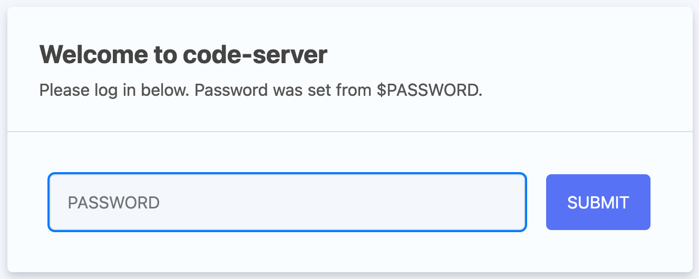
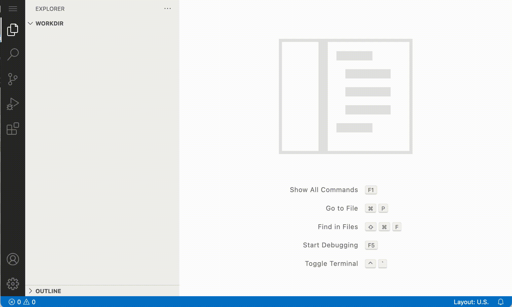
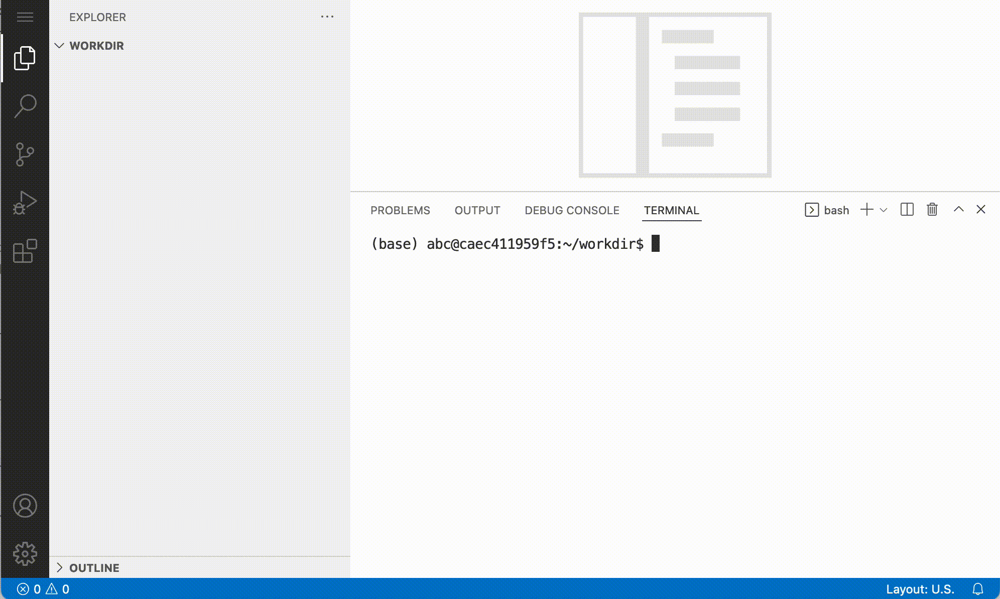

## First login

If you are participating in this course with a teacher, you have received a link and a password. Copy-paste the link (including the port, e.g.: `http://12.345.678.91:10002`) in your browser. This should result in the following page:

{width=300}


::: {.callout-note}
The link gives you access to a web version of [Visual Studio Code](https://code.visualstudio.com). This is a powerful code editor that you can also use as a local application on your computer. 
::: 

Type in the password that was provided to you by the teacher. Now let's open the terminal. You can do that by clicking **Application menu** > **Terminal** > **New Terminal**:

{width=500}


For a.o. efficiency and reproducibility it makes sense to execute your commands from a script. With use of the 'new file' button:

{width=500}

## Get the data

We will start the exercises with pre-aligned bam files. We have already preapred the folders for you with all the data that you need. If you are following the course later on:

::: {.panel-tabset}

## Subscribed to course

You can create a symbolic link to the parent `/data` directory into your project directory `project/`, this simplify the path organization
```bash
cd ~/project
ln -s /data .
```
This allows you to browse the data using VSCode's file explorer within your project.

## If you are following locally (or later):
To start, download and extract to the into a folder, and change your paths to your folder:

```sh
mkdir -p ~/project
cd ~/project
wget https://cancer-variants-training.s3.eu-central-1.amazonaws.com/course_data.tar.gz
tar -xvzf course_data.tar.gz
mv course_data data
rm course_data.tar.gz
```
Then update your paths, depending on where your data is:
```bash
PROJECT=~/project/
ALIGNDIR=~/project/data/alignments
REFDIR=~/project/data/reference
RESOURCEDIR=~/project/data/resources
VEPDBS=~/project/data/VEP_dbs
```

:::

Now, check out the directory `~/project/data` and see what's in there (e.g. with `tree`):

```
└── ~/project/data
    ├── alignments
    │   ├── normal.recal.bai
    │   ├── normal.recal.bam
    │   ├── tumor.recal.bai
    │   └── tumor.recal.bam
    ├── reads
    │   ├── normal_R1.fastq.gz
    │   ├── normal_R2.fastq.gz
    │   ├── tumor_R1.fastq.gz
    │   └── tumor_R2.fastq.gz
    ├── reference
    │   ├── exome_regions.bed.interval_list
    │   ├── ref_genome.dict
    │   ├── ref_genome.fa
    │   ├── ref_genome.fa.fai
    │   └── ref_genome.fa.gz
    ├── resources
    │   ├── 1000G_phase1.snps.high_confidence.hg38.subset.vcf.gz
    │   ├── 1000G_phase1.snps.high_confidence.hg38.subset.vcf.gz.tbi
    │   ├── 1000G_phase1.snps.high_confidence.hg38.vcf.gz
    │   ├── 1000G_phase1.snps.high_confidence.hg38.vcf.gz.tbi
    │   ├── 1000g_pon.hg38.subset.vcf.gz
    │   ├── 1000g_pon.hg38.subset.vcf.gz.tbi
    │   ├── 1000g_pon.hg38.vcf.gz
    │   ├── 1000g_pon.hg38.vcf.gz.tbi
    │   ├── af-only-gnomad.hg38.subset.vcf.gz
    │   ├── af-only-gnomad.hg38.subset.vcf.gz.tbi
    │   ├── af-only-gnomad.hg38.vcf.gz
    │   ├── af-only-gnomad.hg38.vcf.gz.tbi
    │   ├── Mills_and_1000G_gold_standard.indels.hg38.subset.vcf.gz
    │   ├── Mills_and_1000G_gold_standard.indels.hg38.subset.vcf.gz.tbi
    │   ├── Mills_and_1000G_gold_standard.indels.hg38.vcf.gz
    │   ├── Mills_and_1000G_gold_standard.indels.hg38.vcf.gz.tbi
    │   ├── refFlat.txt
    │   └── refFlat.txt.gz
    └── VEP_dbs
        ├── alphamissense
        │   ├── AlphaMissense_hg38.tsv.gz
        │   └── AlphaMissense_hg38.tsv.gz.tbi
        ├── clinvar
        │   ├── clinvar.vcf.gz
        │   └── clinvar.vcf.gz.tbi
        └── revel
            ├── new_tabbed_revel_grch38.tsv.gz
            ├── new_tabbed_revel_grch38.tsv.gz.tbi
            └── new_tabbed_revel.tsv.gz

9 directories, 38 files
```

Showing us that we have three directories:

- `alignments`: containing bam files of tumor and normal
- `reference`: containing the genome fasta file and target intervals
- `resources`: containing amongst other variant files (`vcf`) from among other the [1000 genomes](https://www.internationalgenome.org/) project and [gnomAD](https://gnomad.broadinstitute.org/)
- `VEP_dbs`: Clinvar and alphamissense and revel databases for usage with VEP. 

The dataset we're working with is prepared by the developers of the [Precision medicine bioinformatics course]() by the Griffith lab. It is whole exome sequencing (WES) data of cell lines derived from a tumor of triple negative breast cancer (TNBC) ([HCC1395](https://www.cellosaurus.org/CVCL_1249)) and derived from normal tissue ([HCC1395 BL](https://www.cellosaurus.org/CVCL_1250)). 

You are strongly encouraged to your work with scripts during the course, which you store in the directory `scripts`. 
Therefore create a scripts directory:

```sh
cd ~/project/
mkdir scripts 
```
