## Let's visualize some of the data from our somatic call annotation!

At first we should load one of the vep annotated files from one of the exercises. Let's load the results from **exercise 3** (feel free to load another one!), `chr6ch17_mutect2_annotated_with_clinVar.txt` from the exercise `Cancer-Specific Annotation`.

```{r}
#| echo: true
#| warning: false
#| code-fold: true
#| code-tools: true
#| title: "Some data preprocessing"

# get libraries
library(magrittr)
library(readr)
library(ggplot2)
library(dplyr)
library(tidyr)
library(stringr)

# VEP output in
vep_data <- read_tsv(
  "~/variants/chr6ch17_mutect2_annotated_with_clinVar.txt",
  comment = "##"
)

# better to set up a ggplot2 theme
theme_course <- function() {
  theme_minimal(base_size = 14) +  # Base size affects all text
    theme(
      plot.title = element_text(size = 16, face = "bold"),
      axis.title = element_text(size = 14, face = "bold"),
      axis.text = element_text(size = 12),
      legend.title = element_text(size = 13, face = "bold"),
      legend.text = element_text(size = 12),
      strip.text = element_text(size = 13, face = "bold"),  # For facets
      legend.position = "bottom"
    )
}

# get chr
vep_data <- vep_data %>%
  separate(Location, into = c("chr", "position"), sep=":") %>% 
  mutate(chr = factor(chr, levels = c("chr6", "chr17")))

# Extract IMPACT from Extra column
vep_data$IMPACT <- gsub(".*IMPACT=([^;]+).*", "\\1", vep_data$Extra)

# get nice data out of the df
# returns NA when the field is missing in a row (gsub would return the whole Extra string)
extract_field <- function(data, field) {
  str_match(data$Extra, paste0("(?:^|;)", field, "=([^;]+)"))[, 2]
}

# combine multiple fields
vep_data <- vep_data %>%
  mutate(
    IMPACT = extract_field(., "IMPACT"),
    SYMBOL = extract_field(., "SYMBOL"),
    VARIANT_CLASS = extract_field(., "VARIANT_CLASS"),
    BIOTYPE = extract_field(., "BIOTYPE")
  )

# VEP joins several consequence terms with a comma: one row per term
vep_long <- vep_data %>%
  separate_rows(Consequence, sep = ",")
```

### Exercise 5
::: {.callout-important}
## Visualize the data from VEP

**Objective**: Learn how to quickly visualize your variants.

**Task**: Visualize: 

1. Consequence plot, to visualize the distribution of consequences?
2. Consequence plot, by chromosome?
3. Can we see the consequence colored by impact?
4. Can we see the consequence colored by impact by chromosome?
5. What are the most common variant classes?
6. What are the most common biotypes?
7. Bonus: ClinVar, SIFT, and PolyPhen
8. Bonus: Gene level damage

:::

::: {.callout-tip collapse="true"}
## 1. Consequence plot, to visualize the distribution of consequences
```{r}
#| fig-width: 8
#| fig-height: 6

# consequence plot
ggplot(vep_long, aes(x=reorder(Consequence, table(Consequence)[Consequence]))) +
  geom_bar() +
  coord_flip() +
  theme_minimal() +
  labs(title="Distribution of \n Variant Consequences",
       x="Consequence Type",
       y="Count (transcript annotations)") +
  theme_course()
```
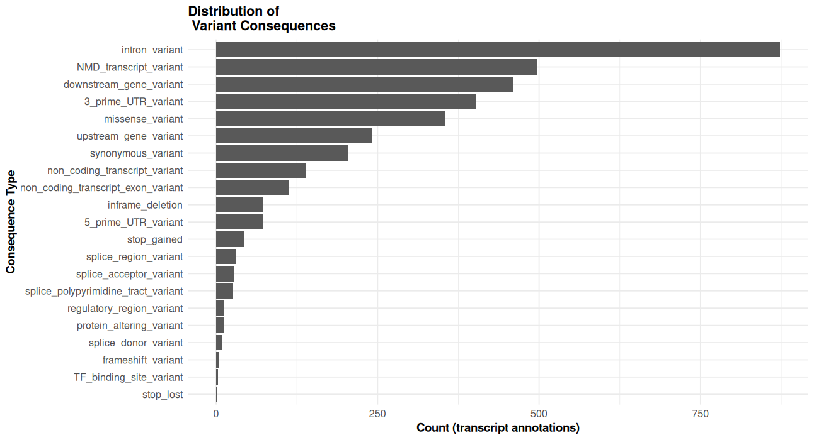

:::

::: {.callout-tip collapse="true"}
## 2. Consequence plot, by chromosome
```{r}
#| fig-width: 8
#| fig-height: 6
# consequence plot 
ggplot(vep_long, aes(x=reorder(Consequence, table(Consequence)[Consequence]))) +
  geom_bar() +
  coord_flip() +
  theme_minimal() +
  labs(title="Distribution of \n Variant Consequences",
       x="Consequence Type",
       y="Count (transcript annotations)") +
  facet_grid(~chr) +
  theme(
    legend.position = "bottom"
  ) +
  theme_course()
```
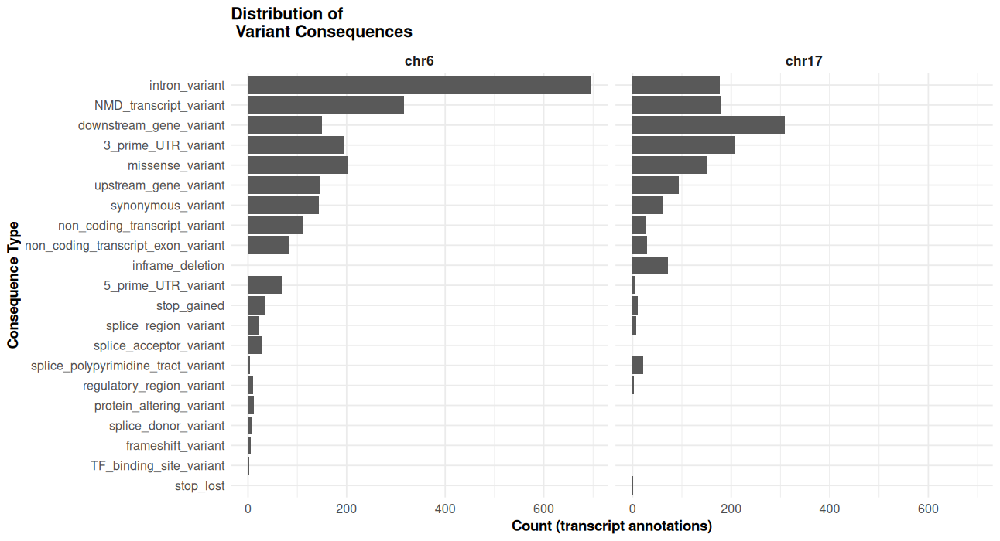
:::


::: {.callout-tip collapse="true"}
## 3. Can we see the consequence colored by impact
```{r}
#| fig-width: 8
#| fig-height: 6

# Impact + Consequence plot
ggplot(vep_long, aes(x=reorder(Consequence, table(Consequence)[Consequence]), fill=IMPACT)) +
  geom_bar() +
  coord_flip() +
  theme_minimal() +
  scale_fill_brewer(palette="Set1") +
  labs(title="Variant Consequences \n by Impact",
       x="Consequence Type",
       y="Count (transcript annotations)") +
  theme(
    legend.position = "bottom"
  ) +
  theme_course()
```
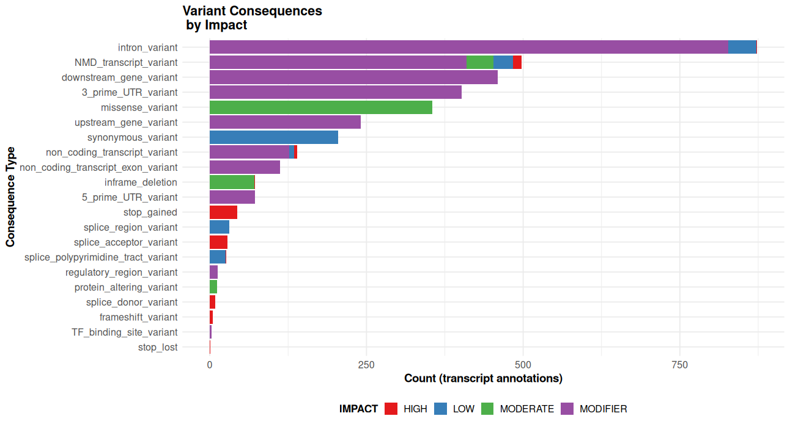
:::


::: {.callout-tip collapse="true"}
## 4. Can we see the consequence colored by impact by chromosome
```{r}
#| fig-width: 8
#| fig-height: 6
# Impact + consequence plot x chr
ggplot(vep_long, aes(x=reorder(Consequence, table(Consequence)[Consequence]), fill=IMPACT)) +
  geom_bar() +
  coord_flip() +
  theme_minimal() +
  scale_fill_brewer(palette="Set1") +
  labs(title="Variant Consequences \n by Impact",
       x="Consequence Type",
       y="Count (transcript annotations)") +
  facet_grid(~chr) +
  theme(
    legend.position = "bottom"
  ) +
  theme_course()
```
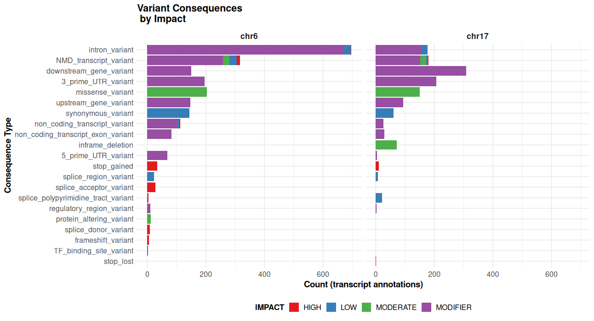
:::


::: {.callout-tip collapse="true"}
## 5. What are the most common variant classes?
```{r}
#| fig-width: 8
#| fig-height: 6
# variant class plot
vep_data %>%
  count(VARIANT_CLASS) %>%  # Count the classees
  arrange(desc(n)) %>%  # Sort in descending ord
  ggplot(aes(x = reorder(VARIANT_CLASS, n), y = n)) +
  geom_bar(stat = "identity", fill = "steelblue") +
  coord_flip() +
  theme_minimal() +
  labs(title = "Distribution of \n Variant Classes",
       x = "Variant Class",
       y = "Count"
       ) +
  theme_course()
```
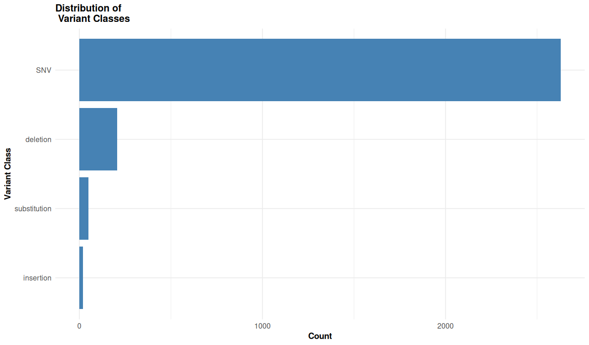
:::


::: {.callout-tip collapse="true"}
## 6. What are the most common biotypes?
```{r}
#| fig-width: 8
#| fig-height: 6
# biotype distribution
ggplot(filter(vep_data, !is.na(BIOTYPE)), aes(x=reorder(BIOTYPE, table(BIOTYPE)[BIOTYPE]))) +
  geom_bar(fill="steelblue") +
  coord_flip() +
  theme_minimal() +
  labs(title="Distribution of \n Biotypes",
       x="Biotype",
       y="Count"
       ) +
  theme_course()
```
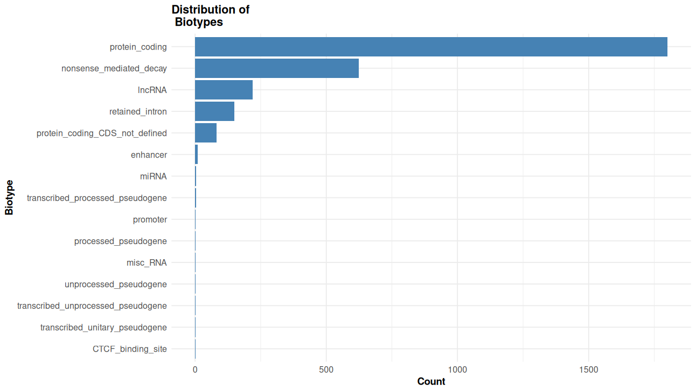
:::

::: {.callout-tip collapse="true"}
## 7. Bonus: ClinVar, SIFT, ans PolyPhen
```{r}
# Extract SIFT
vep_data$sift <- str_extract(vep_data$Extra, "SIFT=.*?;")
vep_data$sift <- str_replace(vep_data$sift, "SIFT=", "") 
vep_data$sift <- str_replace(vep_data$sift, ";", "")
vep_data$sift <- str_replace(vep_data$sift, "\\(.*\\)", "")

# Extract PolyPhen 
vep_data$polyphen <- vep_data$Extra %>%
  str_extract("PolyPhen=.*?;") %>%
  str_replace("PolyPhen=", "") %>%
  str_replace(";", "") %>%
  str_replace("\\(.*\\)", "")

# Extract ClinVar
vep_data$clinvar <- vep_data$Extra %>%
  str_extract("ClinVar_CLNSIG=.*?;") %>%
  str_replace("ClinVar_CLNSIG=", "") %>%
  str_replace(";", "")

# Distribution of SIFT predictions
ggplot(subset(vep_data, !is.na(sift)), 
       aes(x = reorder(sift, table(sift)[sift]))) +
  geom_bar(fill = "steelblue") +
  coord_flip() +
  theme_minimal() +
  labs(title = "Distribution of SIFT Predictions",
       x = "SIFT Prediction",
       y = "Count",
       caption = "Only missense variants are scored by SIFT") +
  theme_course()

# Distribution of PolyPhen predictions 
ggplot(subset(vep_data, !is.na(polyphen)), 
       aes(x = reorder(polyphen, table(polyphen)[polyphen]))) +
  geom_bar(fill = "darkred") +
  coord_flip() +
  theme_minimal() +
  labs(title = "Distribution of PolyPhen Predictions",
       x = "PolyPhen Prediction",
       y = "Count",
       caption = "Only missense variants are scored by PolyPhen") +
  theme_course()
```
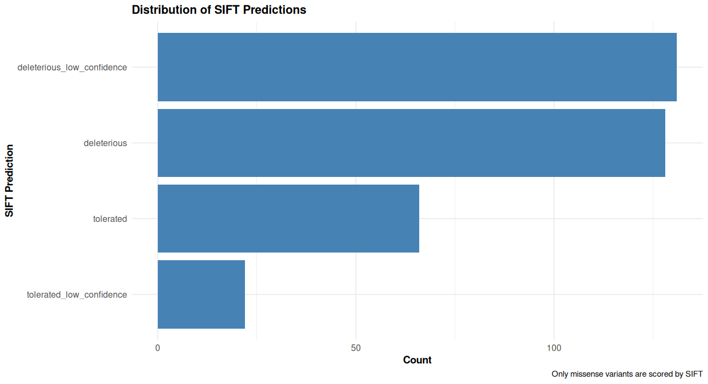
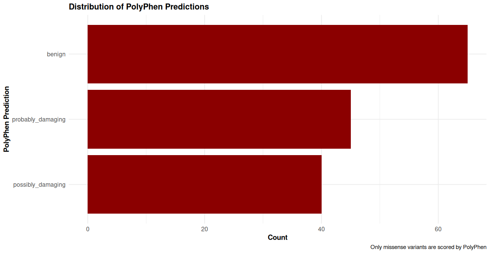

### Combined SIFT and PolyPhen predictions with Impact
```{r}
# Only for variants with both predictions
p3 <- subset(vep_data, !is.na(sift) & !is.na(polyphen)) %>%
  ggplot(aes(x = sift, fill = IMPACT)) +
  geom_bar() +
  facet_wrap(~polyphen) +
  coord_flip() +
  theme_minimal() +
  scale_fill_brewer(palette = "Set1") +
  labs(title = "SIFT and PolyPhen Predictions by Impact",
       x = "SIFT Prediction",
       y = "Count") +
  theme(legend.position = "bottom") +
  theme_course()

# 4. ClinVar significance with impact 
p4 <- subset(vep_data, !is.na(clinvar)) %>%
  ggplot(aes(x = reorder(clinvar, table(clinvar)[clinvar]), fill = IMPACT)) +
  geom_bar() +
  coord_flip() +
  scale_fill_brewer(palette = "Set1") +
  theme_minimal() +
  labs(title = "Clinical Significance by Impact",
       x = "ClinVar Clinical Significance",
       y = "Count") +
  theme(legend.position = "bottom") +
  theme_course()

# 5. For missense variants only - comparison of predictions
p5 <- subset(vep_data, Consequence == "missense_variant" & !is.na(sift) & !is.na(polyphen)) %>%
  ggplot(aes(x = sift, fill = polyphen)) +
  geom_bar(position = "dodge") +
  theme_minimal() +
  scale_fill_brewer(palette = "Set2") +
  labs(title = "SIFT vs PolyPhen Predictions\nfor Missense Variants",
       x = "SIFT Prediction",
       y = "Count",
       fill = "PolyPhen Prediction") +
  theme(axis.text.x = element_text(angle = 45, hjust = 1)) +
  theme_course()
```

### Plots
```{r}
print(p3)
```
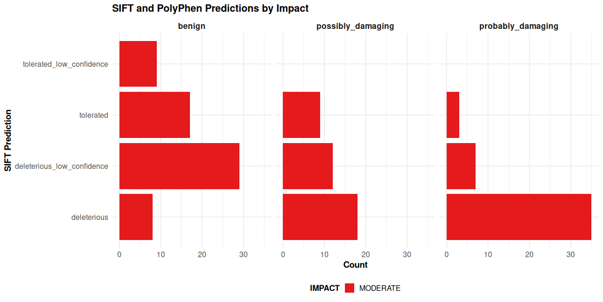

```{r}
print(p4)
```
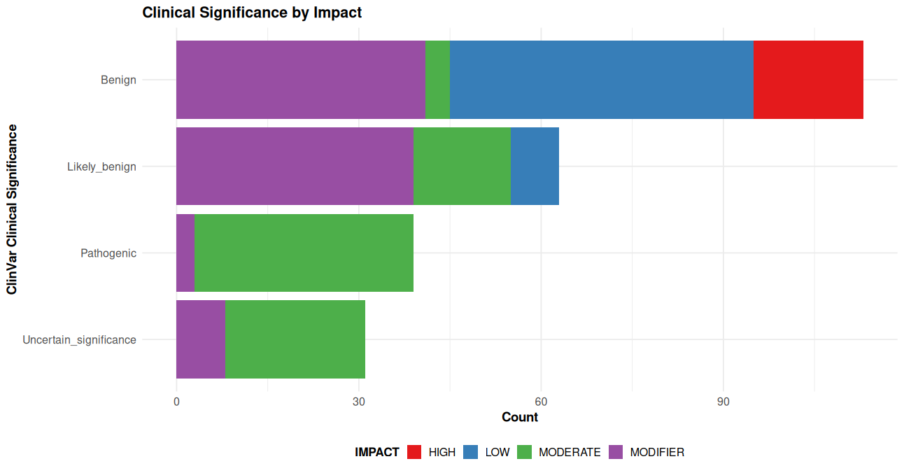

```{r}
print(p5)
```
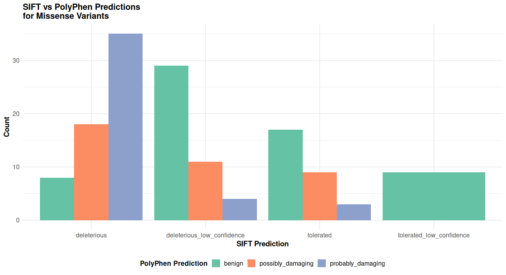

:::

::: {.callout-tip collapse="true"}
## 8. Bonus: Gene level damage
```{r}
# Gene-level summary - most frequently mutated genes
p6 <- vep_data %>%
  filter(!is.na(SYMBOL) & SYMBOL != "") %>%
  count(SYMBOL, chr) %>%
  arrange(desc(n)) %>%
  slice_head(n = 20) %>%
  ggplot(aes(x = reorder(SYMBOL, n), y = n, fill = chr)) +
  geom_col() +
  coord_flip() +
  scale_fill_brewer(palette = "Set1") +
  labs(title = "Top 20 Most Frequently Mutated Genes",
       x = "Gene Symbol",
       y = "Number of Variants",
       fill = "Chromosome") +
  theme_course()

# High impact variants by gene
p7 <- vep_data %>%
  filter(IMPACT %in% c("HIGH", "MODERATE") & !is.na(SYMBOL) & SYMBOL != "") %>%
  count(SYMBOL, IMPACT) %>%
  arrange(desc(n)) %>%
  slice_head(n = 30) %>%
  ggplot(aes(x = reorder(SYMBOL, n), y = n, fill = IMPACT)) +
  geom_col() +
  coord_flip() +
  scale_fill_manual(values = c("HIGH" = "#d62728", "MODERATE" = "#ff7f0e")) +
  labs(title = "Genes with High/Moderate Impact Variants",
       x = "Gene Symbol",
       y = "Number of Variants",
       fill = "Impact Level") +
  theme_course()
```

### Plots
```{r}
print(p6)
```
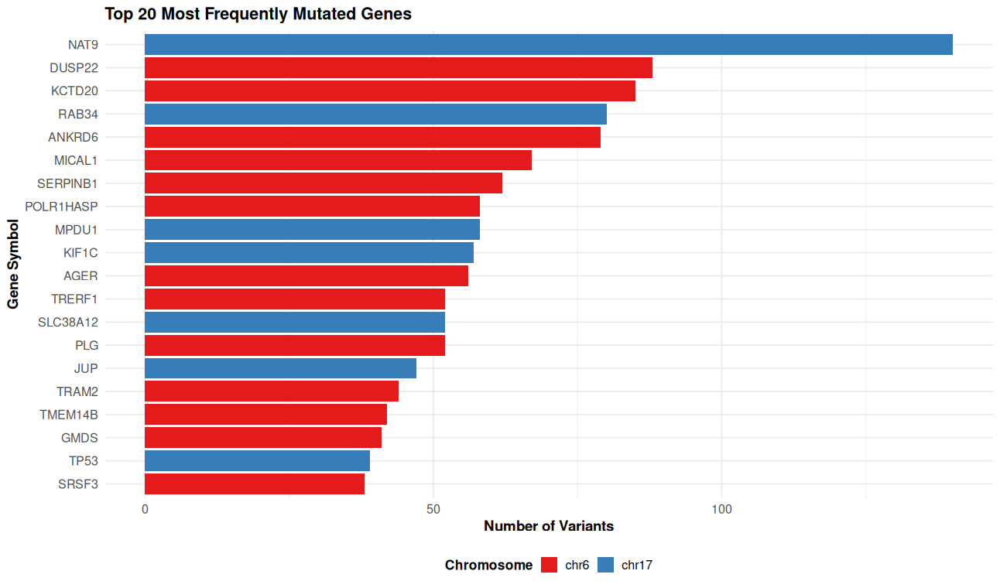

```{r}
print(p7)
```
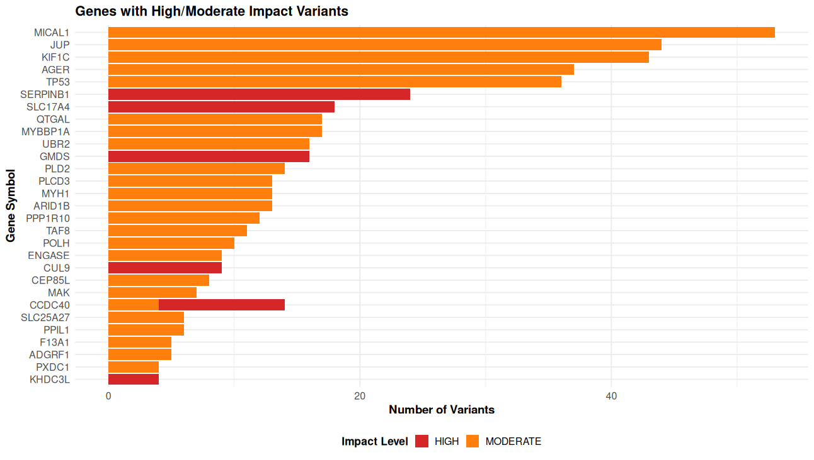


:::
